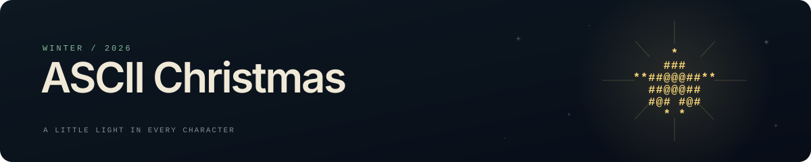

  

  Soft snowfall, golden light, and a little Christmas magic — written in characters.

  <a href="https://nikrozorkin.github.io/ascii-christmas/"><strong>Live demo ↗</strong></a>
  &nbsp; · &nbsp;
  <a href="https://github.com/NikroZorkin/ascii-christmas/releases/download/v1.0.0/ASCII-Christmas-4K.mp4"><strong>Download 4K film</strong></a>

  

  JavaScript + Canvas · Open <code>index.html</code> to run locally.

